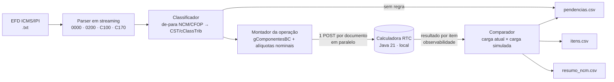

# Simulador de impacto da Reforma Tributária a partir do SPED

Lê uma **EFD ICMS/IPI** ou **XMLs de NF-e**, classifica cada item (CST e cClassTrib da CBS/IBS), calcula **CBS, IBS e Imposto Seletivo** na [Calculadora RTC oficial da Receita Federal](https://github.com/ReceitaFederal/calculadora-rtc-regime-regular) e compara com a carga atual (ICMS, ICMS-ST, IPI, PIS e COFINS), item a item e por NCM.

> Projeto de estudo e portfólio. Os resultados são simulações: as regras de classificação de exemplo são ilustrativas e precisam de revisão da área tributária.

## Arquitetura



Decisões principais:

- **Streaming:** o arquivo é lido linha a linha; um documento (C100 + seus C170) é enviado por vez, com uma janela limitada de envios paralelos. Funciona com arquivos de vários GB sem estourar memória.
- **Endpoint de observabilidade** (`POST /observabilidade/regime-geral`): um item com erro não derruba o documento inteiro; cada erro vem com código (ex.: `REG-011`) e vai para `pendencias.csv`.
- **Base de cálculo pela própria calculadora:** o simulador envia os componentes (`gComponentesBC`: valor do item, desconto, ICMS, PIS, COFINS) e a calculadora aplica a vigência de cada um à data simulada. Assim a regra de base não é reimplementada no Python.
- **De-para em CSV:** a classificação tributária fica em `config/classificacao.csv`, editável pela área fiscal sem mexer em código, e cada linha do relatório diz qual regra foi usada.
- **Tributos remanescentes configuráveis:** em 2027, por exemplo, o ICMS continua integral. A "carga simulada" soma CBS + IBS + IS + os tributos atuais que ainda existem no cenário.
- **Efeito líquido:** saídas geram débito e entradas geram crédito. O resultado principal é o saldo a pagar (débitos − créditos), hoje e no cenário.

## Rumo a produção (v0.3)

### Confiabilidade

- **Versão da calculadora fixada.** `docker-compose.yml` e o Dockerfile usam a tag `1.6.1`, e `[calculadora] versao_esperada` faz a simulação parar (código 3) se a calculadora estiver em outra versão. `simulador-rtc ping` mostra a versão da aplicação e da base.
- **Retentativas em todas as chamadas.** Cálculo e consultas (`ncm`, `ncm-aplicavel`, fichas de classificação) repetem falhas de conexão, timeout e HTTP 5xx com espera exponencial. Erros 4xx não são repetidos.
- **Notas sem itens.** Na EFD, NF-e própria vem só com C190. O simulador registra essas notas e, se o XML correspondente não estiver entre as entradas, avisa no terminal e lista em `notas_sem_itens.csv`.
- **Rastreabilidade.** Cada execução grava `execucao.json`: versão do simulador e da calculadora (aplicação e base), cenário, SHA-256 das entradas e dos arquivos de regra, e os totais.
- **Testes de contrato.** `tests/test_contrato.py` confere o que o simulador espera da calculadora (versão, tabela de NCM, `ncm-aplicavel`, indicadores de crédito, base legal, comportamento de 2026, 2027 e 2033). Os mesmos testes rodam contra o dublê e contra a real, para o dublê não divergir sem ninguém perceber. Contra a real, também comparam o exemplo da distribuidora com `tests/referencia/saude_2027.csv`.

```bash
RTC_URL=http://localhost:8080/api pytest -m contrato
```

Para adotar uma versão nova da calculadora: suba-a, rode os testes de contrato, explique cada diferença em relação à referência e só então atualize `RTC_REF` e `versao_esperada`.

### Créditos nas entradas

Passe várias entradas da mesma empresa num só comando, tipicamente a EFD (compras, com C170) e os XMLs de saída:

```bash
simulador-rtc simular exemplos/saude/efd_icms_ipi_outubro.txt exemplos/saude/nfe \
  --config config/saude.toml --saida resultados_saude
```

- **Crédito hoje:** soma dos tributos de `creditos_atuais` destacados no item de entrada (ex.: ICMS, PIS e COFINS no lucro real).
- **Crédito no cenário:** CBS e IBS do item quando a ficha do cClassTrib na calculadora permite a apropriação pelo adquirente (`indicaApropriacaoCreditoAdquirenteCbs/Ibs`; o 200053 de vacinas, por exemplo, não permite), mais a parte remanescente dos tributos de `creditos_atuais`.
- O Imposto Seletivo não gera crédito.

### Cenários da transição (2026–2033)

`[[cenarios]]` no TOML roda vários cenários na mesma execução (uma pasta por cenário e um resumo em `cenarios.csv`). Cada cenário herda `[simulacao]` e sobrescreve o que declarar. O exemplo `config/saude_transicao.toml` tem um cenário por ano:

```bash
simulador-rtc simular exemplos/saude/efd_icms_ipi_outubro.txt exemplos/saude/nfe \
  --config config/saude_transicao.toml --saida resultados_transicao
```

- **2026:** a calculadora aplica sozinha a alíquota de teste (0,9% de CBS e 0,1% de IBS) e recusa alíquotas nominais. Como o valor é compensável, `cbs_ibs_na_carga = false` o deixa fora da carga.
- **2029 a 2032:** `tributos_remanescentes = { ICMS = 0.9, ICMS_ST = 0.9 }` (e 0,8, 0,7, 0,6) reduz o ICMS remanescente e também o ICMS abatido da base de CBS/IBS. A calculadora não conhece essa redução gradual; a partir de 2033 ela já tira o ICMS da base sozinha.
- **Alíquotas de 2029 em diante são ilustrativas** no exemplo: substitua pelas fixadas pelo Senado, estados e municípios.

### Governança da classificação

- **Base legal** de cada item vem da própria calculadora (`dados-abertos/fundamentacoes-legais`), pelo cClassTrib: por exemplo, 200032 → `LC 214/2025, Art. 133`.
- **Aprovação por regra.** Cada regra tem um `regra_id` estável (`saude:med-anvisa`, `ncm^1006|cfop=*`...). Um CSV da área tributária (`[governanca] aprovacoes`) registra quem aprovou o par (regra, cClassTrib) e quando. Se a regra passar a produzir outro código, a aprovação deixa de valer.
- Com `exigir_aprovacao = true`, item classificado por regra sem aprovação vai para `revisao.csv` com o alerta `REGRA_NAO_APROVADA`.
- `regras_usadas.csv` é a trilha de auditoria: cada regra usada, seu código, base legal, aprovação, quantidade de itens e valor.

### Na AWS com Step Functions (estudo)

[infra/](infra/README.md) publica o mesmo simulador na AWS: uma máquina de estados confere a calculadora (no Fargate), simula os cenários em paralelo (Map), consolida e, se houver itens para revisão, **pausa até a área tributária aprovar** (SNS + task token). Retentativas, desvios de erro e histórico de cada execução ficam na Step Function, e qualquer falha que sobra depois das retentativas avisa a equipe no Slack (SNS + AWS Chatbot). A regra de negócio continua no mesmo pacote Python, chamada por handlers finos em `src/simulador_rtc/aws/handlers.py`.

## Setor de saúde: distribuidora de medicamentos e produtos hospitalares (v0.2)

O motor `setores/saude.py` aplica duas lógicas, conforme o que a calculadora consegue validar:

| Tipo de item | O que decide o tratamento | Fonte |
|---|---|---|
| Medicamentos, soros e vacinas | registro na Anvisa, lista de alíquota zero, tipo de comprador | cadastro de produtos, grupo `med/cProdANVISA` da NF-e e cadastro de participantes |
| Dispositivos médicos, acessibilidade, nutrição | NCM nos Anexos IV, V, VI, XII e XIII | endpoint `ncm-aplicavel` da calculadora (com cache) |

Achado que motivou essa divisão: na calculadora 1.6.1, os cClassTrib de medicamentos aceitam **qualquer NCM** (inclusive seringa e cadeira de rodas), enquanto os de dispositivos e acessibilidade aceitam só os NCMs dos anexos. Exemplos confirmados na calculadora: seringa `90183119` → 200030 (Anexo IV, 60%); cadeira de rodas `87139000` → 200007 (Anexo XIII, alíquota zero).

O `ncm-aplicavel` confere só a lista do anexo e responde `valido=true` até para NCM extinto (ex.: `40151100`). Por isso o simulador consulta `GET /dados-abertos/ncm` antes de classificar (com cache por NCM) e manda NCMs inexistentes para `pendencias.csv` com estado `NCM_INEXISTENTE`. Para desligar, use `validar_ncm = false` em `[simulacao]`.

Regras, em ordem de prioridade:

1. **Medicamento ou soro/vacina sem registro na Anvisa** → tributação integral e alerta `MEDICAMENTO_SEM_REGISTRO_ANVISA`.
2. **Comprador órgão público** → 200010. **Entidade de saúde imune (CEBAS)** → 200010 com alerta `CONFIRMAR_CODIGO_ENTIDADE_IMUNE` (a LC 214 prevê alíquota zero, mas a descrição do código cita só órgãos públicos).
3. **Soro ou vacina** → 200053. **Medicamento na lista de alíquota zero** → 200009. **Demais medicamentos** → 200032 (60%).
4. **Dispositivo, acessibilidade ou nutrição** → primeira classificação aceita pelo `ncm-aplicavel`, alíquota zero antes de 60%: 200004 → 200005 → 200030; 200007 → 200008 → 200031; 200011 → 200033. Classificações exclusivas de órgão público ou entidade imune só são testadas para esses compradores.
5. **Produto sem cadastro** → tenta todos os anexos pelo NCM, com alertas `PRODUTO_SEM_CADASTRO` e `CLASSIFICADO_SO_PELO_NCM`.

Rodando o exemplo (3 NF-e fictícias: hospital privado, prefeitura e Santa Casa):

```bash
simulador-rtc simular exemplos/saude/nfe --config config/saude.toml --saida resultados_saude
```

Arquivos de apoio: `config/saude.toml`, `exemplos/saude/cadastro_produtos.csv` e `exemplos/saude/participantes.csv`.

> **Atenção ao PIS/COFINS monofásico:** na distribuidora, medicamentos saem com PIS/COFINS zerado (CST 04), porque o tributo foi pago pela indústria e está embutido no preço. Por isso a carga simulada de um medicamento com redução de 60% pode ficar **maior** que a atual nessa etapa da cadeia, sem que a carga da cadeia toda aumente. Para uma comparação justa, analise a cadeia (indústria + distribuidora) ou o custo efetivo.

## Como rodar

### 1. Suba a calculadora oficial

Com Docker (constrói a partir do repositório da Receita):

```bash
docker compose up -d --build
```

Ou manualmente, seguindo o README da calculadora (Java 21):

```bash
git clone https://github.com/ReceitaFederal/calculadora-rtc-regime-regular.git
cd calculadora-rtc-regime-regular
mkdir -p ./calculadora/db
./mvnw flyway:migrate -Dflyway.configFiles=./flyway/flyway-pro.conf --batch-mode --errors
./mvnw spring-boot:run -Dspring-boot.run.profiles=offline
```

A API fica em `http://localhost:8080/api` (Swagger em `/api/swagger-ui.html`).

### 2. Instale e rode o simulador

```bash
python -m venv .venv && source .venv/bin/activate
pip install -e ".[dev]"

simulador-rtc ping
simulador-rtc simular exemplos/efd_icms_ipi_ficticio.txt --saida resultados
```

Saída no terminal (exemplo com o arquivo fictício):

```
Itens: 5 | calculados: 4 | pendentes: 1 | documentos ignorados (cancelados etc.): 1
Carga atual (ICMS+ST+IPI+PIS+COFINS): R$ 3,844.53
Carga simulada (CBS+IBS+IS+ICMS+ICMS_ST): R$ ...
```

### 3. Testes

```bash
pytest
```

Os testes usam um **dublê** da calculadora (`tests/fake_calculadora.py`) que aplica uma regra simplificada só para validar o fluxo. Os valores reais vêm da calculadora oficial. Para rodar também os testes de contrato contra a calculadora real:

```bash
RTC_URL=http://localhost:8080/api pytest
```

## Configuração (`config/simulacao.toml`)

| Chave | Para quê |
|---|---|
| `calculadora.url` | Endereço da calculadora local |
| `calculadora.workers` | Documentos enviados em paralelo |
| `simulacao.dh_fato_gerador` | Data simulada; a calculadora aplica as regras vigentes nessa data |
| `simulacao.aliquotas_nominais` | Obrigatórias a partir de 2027 (proibidas antes). Os valores de exemplo vêm da documentação oficial da calculadora |
| `simulacao.tributos_remanescentes` | Tributos atuais que continuam no cenário (ex.: `["ICMS", "ICMS_ST"]` em 2027) |
| `simulacao.classificacao_csv` | Arquivo de de-para NCM/CFOP → CST/cClassTrib |
| `simulacao.validar_ncm` | Confere se cada NCM existe na tabela da calculadora na data simulada |
| `simulacao.creditos_atuais` | Tributos atuais que a empresa credita hoje nas entradas |
| `simulacao.cbs_ibs_na_carga` | `false` no ano de teste (2026), em que a CBS/IBS é compensável |
| `calculadora.versao_esperada` | Versão da calculadora exigida (a simulação para se for outra) |
| `[[cenarios]]` | Vários cenários na mesma execução; cada um precisa de `nome` |
| `governanca.aprovacoes` / `governanca.exigir_aprovacao` | CSV de aprovações das regras e se a falta de aprovação vira alerta |

`tributos_remanescentes` aceita lista (tributos integrais) ou tabela com a fração que resta (`{ ICMS = 0.9 }`).

## Saídas

| Arquivo | Conteúdo |
|---|---|
| `itens.csv` | Uma linha por item: tributos atuais, base e valores de CBS/IBS/IS, regra de classificação usada, estado do cálculo |
| `resumo_ncm.csv` | Carga atual × simulada por NCM, em R$ e em % do valor dos itens |
| `pendencias.csv` | Itens sem classificação ou com erro da calculadora, com o código e a descrição do erro |
| `revisao.csv` | Itens calculados, mas com alerta para revisão humana (ex.: medicamento sem registro na Anvisa) |
| `resumo_tratamento.csv` | Carga atual × simulada por cClassTrib (tratamento tributário) |
| `regras_usadas.csv` | Cada regra usada: regra_id, cClassTrib, base legal, aprovação, itens e valor |
| `execucao.json` | Versões, cenário, SHA-256 das entradas e regras, e totais (débitos, créditos, saldo) |
| `notas_sem_itens.csv` | Notas da EFD sem C170 e sem o XML correspondente (ficaram fora da simulação) |
| `cenarios.csv` | Com `[[cenarios]]`: débitos, créditos e saldo de cada cenário, lado a lado |

Em `itens.csv`, `natureza` diz se o item é `DEBITO` (saída) ou `CREDITO` (entrada), e `credito_atual`/`credito_novo` trazem o crédito das entradas.

## Limitações conhecidas

- Na EFD ICMS/IPI, lê só o C170, que normalmente existe nas **entradas** e nas saídas que não são NF-e própria. Para as saídas próprias, use os XMLs de NF-e (as notas sem C170 e sem XML são listadas em `notas_sem_itens.csv`).
- XMLs de NF-e de compra (emitidos pelo fornecedor) ainda não são lidos como entrada: as entradas vêm da EFD.
- Crédito: não distingue compras sem direito a crédito (uso e consumo pessoal, por exemplo); `creditos_atuais` vale para todas as entradas.
- Na EFD, frete, seguro e outras despesas do C100 ainda não são rateados aos itens (na NF-e eles já vêm por item).
- A lista de medicamentos com alíquota zero vem do cadastro (`aliquota_zero = S`); o simulador não confere a substância contra a LC 214.
- Imposto Seletivo: ligado pelas colunas `is_*` do de-para, com alíquota ad valorem simulada. Alíquota ad rem e unidade tributável específica ainda não são tratadas.
- A calculadora evolui a cada release e as tabelas têm vigência: a versão fica fixada em `RTC_REF` e `versao_esperada`, e é registrada em `execucao.json`.

## Roadmap

- [x] Leitor de XML de NF-e para as saídas próprias
- [x] Motor de regras do setor de saúde (perfil distribuidora)
- [ ] Perfis hospital e indústria no setor de saúde
- [ ] EFD-Contribuições (créditos de PIS/COFINS → CBS)
- [x] Créditos nas compras pelos indicadores de apropriação da calculadora
- [x] Cenários da transição 2026–2033 numa execução
- [x] Base legal e aprovação por regra de classificação
- [x] Versão da calculadora fixada, retentativas e testes de contrato
- [ ] Crédito presumido e compras sem direito a crédito
- [ ] Banco de resultados (por execução) e painel para as áreas tributária e financeira
- [ ] Rateio de frete, seguro e outras despesas por item
- [ ] Dashboard (Streamlit) com o resumo por NCM e CFOP
- [ ] Sugestão de cClassTrib a partir das tabelas de dados abertos

## Dados

Use apenas arquivos **fictícios ou anonimizados**. O `.gitignore` já bloqueia a pasta `dados/` e arquivos `.sped`. O arquivo em `exemplos/` é inteiramente inventado.

## Licença

MIT. A Calculadora RTC é da Receita Federal do Brasil, também sob licença MIT.
