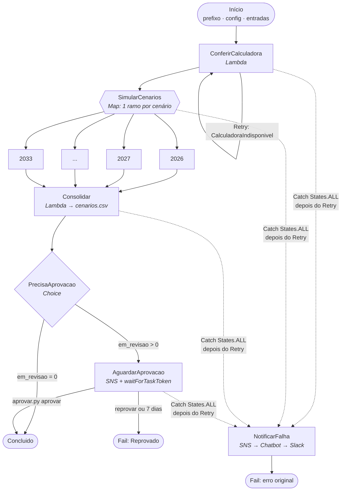

# Simulador RTC na AWS com Step Functions (versão de estudo)

Esta pasta publica o simulador na AWS com a orquestração feita pelo **AWS Step Functions**. A regra de negócio é a mesma da CLI. O que muda é **quem coordena as etapas**: a ordem, o paralelismo, as retentativas e a pausa para aprovação humana saem do Python e vão para uma máquina de estados declarativa ([state_machine.asl.json](state_machine.asl.json)).

## O fluxo



| Estado | Tipo | O que ensina |
|---|---|---|
| `ConferirCalculadora` | Task (Lambda) | `Retry` por nome de erro: `CalculadoraIndisponivel` é repetido com backoff enquanto o container sobe. `VersaoDivergente` não está no `Retry` (não adianta repetir) e cai direto no `Catch`. `Assign` guarda variáveis (`$entrada`, `$registro`) para os estados seguintes. |
| `SimularCenarios` | Map | Paralelismo declarativo (`MaxConcurrency: 4`). `ItemSelector` monta o evento de cada ramo. |
| `Consolidar` | Task (Lambda) | Junta a saída do Map (uma lista) num CSV. |
| `PrecisaAprovacao` | Choice | Desvio por condição JSONata. |
| `AguardarAprovacao` | Task (SNS `.waitForTaskToken`) | Integração direta com o SNS, sem Lambda intermediária. A execução **pausa** até alguém devolver o token, e você não paga computação enquanto espera. |
| `NotificarFalha` | Task (SNS `publish`) | Ponto único de alerta: todo `Catch States.ALL` desvia para cá. A mensagem é montada em JSONata no formato do AWS Chatbot. |
| `Concluido` / `Falhou` / `Reprovado` | Succeed / Fail | Fim explícito. O `Falhou` carrega o erro original (ex.: `VersaoDivergente`), não o do SNS. |

O nome da classe da exceção Python vira o `Error` do estado. É assim que `Retry` e `Catch` sabem o que aconteceu (veja [handlers.py](../src/simulador_rtc/aws/handlers.py)).

### Retry × Catch: quem avisa o Slack

A ordem é sempre **Retry primeiro, Catch depois**. O `Retry` repete em silêncio, sem sair do estado. Só quando as tentativas acabam, ou quando o erro nem está no `Retry` (caso do `VersaoDivergente`), o `Catch` entra em ação. Por isso a notificação fica no `Catch`: a equipe é avisada da **falha**, e não de cada soluço que se resolveu sozinho.

Cada `Catch` guarda o erro e o nome do estado em `$falha` (com `Assign`) e segue para `NotificarFalha`, que publica no tópico de alertas e termina em `Falhou`. Se a própria notificação falhar, a execução ainda termina com o erro original. A reprovação humana **não** notifica, porque é decisão de negócio e não falha técnica.

Exemplo de mensagem no canal:

> 🚨 **Simulador RTC falhou em ConferirCalculadora**
> **Erro:** `CalculadoraIndisponivel`
> **Execução:** demo-20261123-101500
> **Detalhe:** {"errorMessage": "Calculadora não responde em http://calculadora.rtc.local:8080/api", ...}
> [Abrir a execução no console](#)

## A infraestrutura

```
                         ┌──────────────── VPC ────────────────────────────────┐
 você ── demo.py ──> S3  │  subnets isoladas            subnet pública          │
                     ▲   │  ┌──────────────┐  :8080    ┌────────────────────┐  │
 Step Functions ─────┼───┼─>│ 3 Lambdas    │──────────>│ Calculadora RTC    │  │
      │              └───┼──│ (simulador)  │ Cloud Map │ (Fargate, Java)    │  │
      │      S3 endpoint │  └──────────────┘ DNS       └────────────────────┘  │
      └──> SNS ──> e-mail└──────────────────────────────────────────────────────┘
```

O stack foi feito para ser barato e descartável:
- **Sem NAT Gateway e sem load balancer.** A calculadora fica numa subnet pública, mas o security group só aceita conexões das Lambdas. As Lambdas a encontram por DNS privado (`calculadora.rtc.local`).
- **Lambdas em subnets isoladas**, falando com o S3 por um VPC endpoint gratuito.
- **`cdk destroy` apaga tudo**, inclusive o bucket.

## Como rodar

Pré-requisitos (no WSL): conta AWS com credenciais configuradas (`aws configure`), Docker rodando e Node.js (para o CDK CLI).

```bash
cd infra
python3 -m venv .venv && .venv/bin/pip install -r requirements.txt
source .venv/bin/activate

npx aws-cdk@2 bootstrap                       # uma vez por conta/região
npx aws-cdk@2 deploy -c email_aprovacao=voce@exemplo.com
```

O e-mail é opcional. Se você informar, confirme a inscrição no link que o SNS envia. O primeiro deploy demora, porque constrói a imagem da calculadora (Maven) e o pacote das Lambdas.

### Alertas no Slack (opcional)

1. No console da AWS, abra **AWS Chatbot** (hoje *Amazon Q Developer in chat applications*), clique em **Configure new client → Slack** e autorize o workspace. Isso acontece uma vez por conta e pode exigir um admin do Slack.
2. Anote o **Workspace ID** (`T...`), que aparece no console depois da autorização, e o **Channel ID** (`C...`), que fica em *Detalhes do canal* no Slack.
3. Convide o app para o canal (`/invite @Amazon Q`, ou `@aws` em workspaces mais antigos).
4. Publique com os IDs:

```bash
npx aws-cdk@2 deploy -c slack_workspace_id=T0123456789 -c slack_channel_id=C0123456789
```

Sem esses parâmetros, o tópico de alertas é criado mesmo assim, só que ninguém o assina.

**Para ver um alerta chegar:** publique com `-c calculadora_tarefas=0` (a calculadora desligada) e rode `python demo.py`. Depois das 8 tentativas (uns 7 minutos), o `Catch` dispara e a mensagem chega no canal. Para voltar ao normal, publique de novo com `-c calculadora_tarefas=1`. Com isso você também pode usar o *Redrive* na execução que falhou.

Rodar o exemplo da distribuidora (transição 2026–2033):

```bash
python demo.py --esperar
```

Os cenários do exemplo têm itens para revisão, então a execução para em `AguardarAprovacao`:

```bash
python aprovar.py aprovar --por "Seu nome"       # segue para Concluido
python aprovar.py reprovar --motivo "..."        # termina em Reprovado
```

Os resultados ficam em `s3://<bucket>/resultados/<execução>/<cenário>/` (itens.csv, resumo_ncm.csv, revisao.csv, execucao.json...), mais o `cenarios.csv` na raiz da execução.

### O que observar no console

Abra o link que o `demo.py` imprime:
1. **Graph view:** o fluxo ganha cor conforme avança. Clique num estado para ver a entrada e a saída.
2. **Map run:** cada cenário aparece como uma iteração, com duração própria.
3. **Event history:** procure `TaskFailed` com `CalculadoraIndisponivel` seguido de nova tentativa. É o `Retry` funcionando enquanto o container sobe.
4. Em `AguardarAprovacao`, a execução fica **Running** sem nada processando. Depois de aprovar, o `aprovado_por` aparece na saída do estado e fica como trilha de auditoria.
5. **Catch:** numa execução que falhou, o grafo mostra o desvio para `NotificarFalha` → `Falhou`, e a saída de `NotificarFalha` traz o `MessageId` do SNS.
6. **Redrive:** depois de corrigir a causa, *Redrive* continua do estado que falhou, sem reprocessar o que já tinha dado certo.

## Custos e limpeza

- **Fargate (1 vCPU, 2 GB) + IP público:** cerca de US$ 0,05/hora enquanto o stack existir. É o principal custo.
- **Step Functions:** a camada gratuita cobre 4.000 transições/mês, e uma execução da demo usa umas 20.
- **Lambda, S3 e SNS:** centavos.

```bash
npx aws-cdk@2 deploy -c calculadora_tarefas=0    # pausa a calculadora
npx aws-cdk@2 destroy                            # apaga tudo
```

## Testes sem AWS

`tests/test_aws.py` chama os handlers na mesma sequência da máquina de estados, com uma pasta local no lugar do S3 (`ARMAZENAMENTO_LOCAL`) e o dublê da calculadora. Também confere a estrutura do ASL: todo `Next` aponta para um estado existente e todo `${...}` é substituído pelo stack.

```bash
pytest tests/test_aws.py
```

## Exercícios para continuar

1. **Ligar a calculadora sob demanda:** um estado inicial que chama `ecs:updateService` (integração direta, sem Lambda) com `desiredCount: 1` e um `Wait`/`Choice` em laço até ela responder; um estado final que volta para 0.
2. **Disparo automático:** uma regra do EventBridge que inicia a execução quando um arquivo chega em `entradas/`.
3. **Distributed Map:** em vez de um ramo por cenário, um ramo por lote de documentos de uma EFD grande lida do S3.
4. **Aprovação por link:** uma Lambda com Function URL que recebe o token e chama `SendTaskSuccess`, para aprovar clicando no e-mail.
5. **Parser em ECS:** para EFDs de vários GB (Lambda tem limite de 15 min), um estado `ecs:runTask.sync`.
